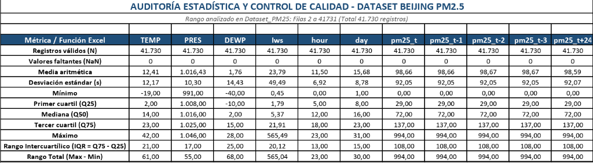
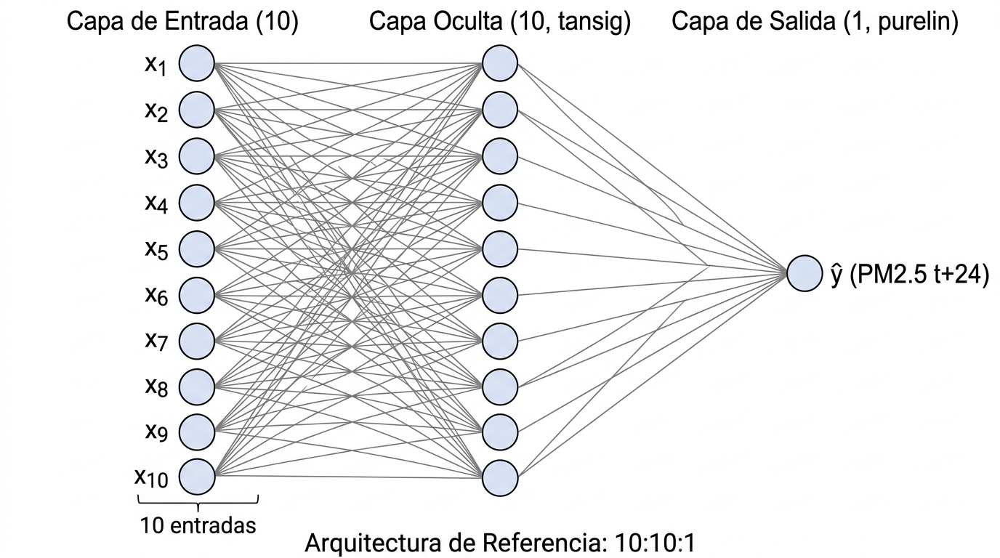
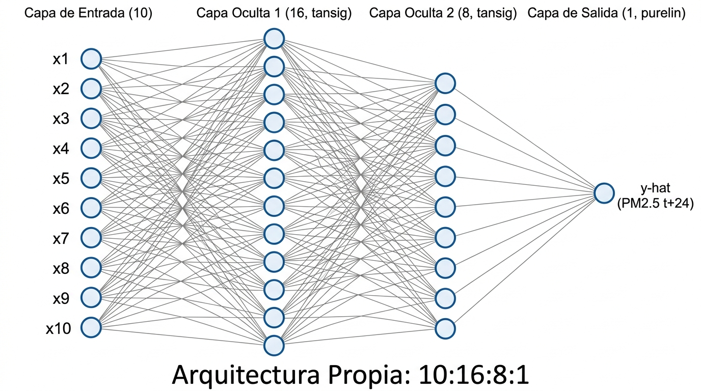

# TERCER TALLER: REDES NEURONALES MULTICAPA (MLP)
### Predicción de Material Particulado Fino (PM2.5 a 24 horas) mediante Perceptrón Multicapa y Backpropagation

<p align="center">
  
  
  
  
  <a href="https://colab.research.google.com/drive/1eXevX6U_6He5snGHMdMV9cGOJR5pyI5L?usp=sharing" target="_blank">
    
  </a>
  
</p>

---

## Documentos de Trabajo y Enlaces de Acceso Rápido

> **Recursos centrales del proyecto:**
> * 📄 **Documento de Trabajo Formal:** [`docs/Taller_RNA_MLP_IA_PALMERA_CAMARGO.docx`](docs/Taller_RNA_MLP_IA_PALMERA_CAMARGO.docx) *(Manuscrito técnico estructurado en OnlyOffice / Word)*.
> * 📊 **Libro de Auditoría y Control de Calidad (Excel):** [`docs/Auditoria_Estadistica_Dataset_PM25.xlsx`](docs/Auditoria_Estadistica_Dataset_PM25.xlsx) *(41.730 filas con fórmulas dinámicas sobre el rango `A2:K41731`)*.
> * 📓 **Cuaderno Interactivo en la Nube:** [Google Colab — Auditoría Estadística Beijing PM2.5](https://colab.research.google.com/drive/1eXevX6U_6He5snGHMdMV9cGOJR5pyI5L?usp=sharing).
> * 💻 **Notebook Local de Verificación:** [`notebooks/01_auditoria_y_verificacion_dataset_pm25.ipynb`](notebooks/01_auditoria_y_verificacion_dataset_pm25.ipynb).

---

## Información Institucional y Académica

* **Institución:** Universidad de Cartagena
* **Facultad:** Facultad de Ingeniería
* **Programa:** Ingeniería de Sistemas — Semestre VII
* **Asignatura:** Inteligencia Artificial (Segundo Corte)
* **Docente:** Manuel Alejandro Ospina Alarcón
* **Autores:**
  * **Dago David Palmera Navarro** — Código Estudiantil `0222321003`
  * **Julián David Camargo Padilla** — Código Estudiantil `0222320016`
* **Ponderación:** 8 puntos de la calificación definitiva del corte
* **Fecha de Publicación Oficial:** Miércoles 07 de octubre de 2026 (14:39 en Google Classroom)
* **Fecha Límite de Entrega:** Viernes 16 de octubre de 2026, 11:59 p. m.

---

## Tabla de Contenido

1. [Descripción General del Problema](#descripción-general-del-problema)
2. [Descripción Técnica del Dataset](#descripción-técnica-del-dataset)
3. [Control de Calidad y Auditoría Estadística](#control-de-calidad-y-auditoría-estadística)
4. [Estrategia de Partición y Preprocesamiento](#estrategia-de-partición-y-preprocesamiento)
5. [Diseño y Comparación de Arquitecturas](#diseño-y-comparación-de-arquitecturas)
6. [Estructura del Directorio del Proyecto](#estructura-del-directorio-del-proyecto)
7. [Requisitos y Configuración del Entorno](#requisitos-y-configuración-del-entorno)
8. [Licencia](#licencia)

---

## Descripción General del Problema

El objetivo de esta actividad evaluativa es modelar, entrenar, validar y comparar arquitecturas de **Redes Neuronales Multicapa (MLP)** para la predicción de la concentración de material particulado fino **PM2.5 a 24 horas hacia adelante ($t+24$)** en la ciudad de Beijing, China.

El problema presenta retos analíticos característicos de los sistemas dinámicos reales:
* **Multivariabilidad:** Interacción conjunta de variables meteorológicas (temperatura, presión, punto de rocío y velocidad del viento) y factores de temporalidad humana y climática.
* **Dependencia temporal y autocorrelación:** Fuerte inercia autoregresiva del contaminante en instantes previos ($pm25_t, pm25_{t-1}, pm25_{t-2}, pm25_{t-3}$).
* **No linealidad:** Dinámicas atmosféricas complejas que no pueden resolverse con hiperplanos simples (limitación clásica demostrada por Minsky y Papert), exigiendo capas ocultas con funciones de activación continuas diferenciables (`tansig`) optimizadas mediante **Backpropagation**.

---

## Descripción Técnica del Dataset

Se utiliza una versión preprocesada del **Beijing PM2.5 Dataset** (`data/datasets/dataset_pm25.csv`), conformado por **41.730 observaciones** y **11 variables**:

| Variable | Tipo | Unidad / Rango | Rol en el Modelo | Justificación Técnica |
| :--- | :---: | :---: | :---: | :--- |
| `TEMP` | Continua | $^\circ\text{C}$ | Entrada (Meteorológica) | Modula la velocidad de reacciones fotoquímicas y la estabilidad atmosférica vertical. |
| `PRES` | Continua | $\text{hPa}$ | Entrada (Meteorológica) | Condiciona fenómenos anticiclónicos de acumulación o turbulencia de dispersión. |
| `DEWP` | Continua | $^\circ\text{C}$ | Entrada (Meteorológica) | Punto de rocío; indicador de humedad relativa y formación de aerosoles secundarios. |
| `Iws` | Continua | $\text{m/s}$ | Entrada (Meteorológica) | Velocidad acumulada del viento; factor fundamental de ventilación y transporte. |
| `hour` | Discreta | $0 - 23$ | Entrada (Temporal) | Ciclo diurno humano (horas pico de tráfico vehicular, actividad industrial y radiación solar). |
| `day` | Discreta | $1 - 31$ | Entrada (Temporal) | Estacionalidad y calendario del ciclo mensual de emisión. |
| `pm25_t` | Continua | $\mu g/m^3$ | Entrada (Autorregresiva) | Concentración actual de PM2.5 en el instante $t$ (regresor de orden 0). |
| `pm25_t-1` | Continua | $\mu g/m^3$ | Entrada (Autorregresiva) | Retardo de 1 hora previa (inercia inmediata de la serie temporal). |
| `pm25_t-2` | Continua | $\mu g/m^3$ | Entrada (Autorregresiva) | Retardo de 2 horas previas (captura de tendencia sostenida). |
| `pm25_t-3` | Continua | $\mu g/m^3$ | Entrada (Autorregresiva) | Retardo de 3 horas previas (memoria de acumulación de partículas). |
| **`pm25_t+24`** | **Continua** | $\mu g/m^3$ | **Salida Objetivo (Target)** | **Concentración de PM2.5 a predecir a 24 horas hacia adelante.** |

---

## Control de Calidad y Auditoría Estadística

A fin de eliminar la concepción de "caja negra" y sustentar documentalmente la calidad del dataset, la verificación se realizó en dos niveles independientes:

### 1. Auditoría Paramétrica en Excel / OnlyOffice
Se construyó el libro [`docs/Auditoria_Estadistica_Dataset_PM25.xlsx`](docs/Auditoria_Estadistica_Dataset_PM25.xlsx), donde cada métrica fue calculada mediante **fórmulas dinámicas nativas** sobre el rango `Dataset_PM25!A2:K41731`:
* Conteo de registros válidos: `=CONTAR(Dataset_PM25!X2:X41731)` $\to$ `41.730`.
* Detección de datos nulos/vacíos: `=CONTAR.BLANCO(Dataset_PM25!X2:X41731)` $\to$ `0`.
* Media aritmética y desviación estándar: `=PROMEDIO(...)` y `=DESVEST.M(...)`.
* Cuartiles y percentiles: `=PERCENTIL.INC(..., 0.25)` y `=PERCENTIL.INC(..., 0.75)`.

<p align="center">
  
</p>

### 2. Verificación Programática en Python y Google Colab
Disponible en el cuaderno interactivo [Google Colab](https://colab.research.google.com/drive/1eXevX6U_6He5snGHMdMV9cGOJR5pyI5L?usp=sharing), validando tipos de datos (`float64`, `int64`) y confirmando con Pandas la ausencia total de nulos en todas las columnas.

---

## Estrategia de Partición y Preprocesamiento

1. **Partición Cronológica (80% / 20%):**
   * **Entrenamiento (*Train*):** 33.384 observaciones (filas 2 a 33.385).
   * **Prueba (*Test*):** 8.346 observaciones (filas 33.386 a 41.731).
   * *Justificación:* Al tratarse de una serie temporal, una partición aleatoria provocaría **fuga temporal de datos (*temporal data leakage*)**, entrenando al modelo con observaciones del futuro respecto al conjunto de prueba.
2. **Normalización Min-Max simétrica en $[-1, +1]$:**
   $$x'_j = 2 \cdot \left( \frac{x_j - x_{j,\min}^{train}}{x_{j,\max}^{train} - x_{j,\min}^{train}} \right) - 1$$
   * Los parámetros $x_{\min}$ y $x_{\max}$ se ajustan **estrictamente sobre el conjunto de entrenamiento** para blindar al modelo contra fuga de datos (*data leakage*).
   * Compatible con la función de activación `tansig` en capas ocultas.

---

## Diseño y Comparación de Arquitecturas

Se definieron dos modelos neuronales para evaluación comparativa bajo idénticos hiperparámetros ($\eta = 0,01$, 500 épocas, optimización *Full-Batch*):

### 1. Arquitectura de Referencia (Sugerida: 10:10:1)
Topología base sugerida en la guía del docente con una sola capa oculta:
$$\mathbf{10} \xrightarrow{\text{tansig}} \mathbf{10} \xrightarrow{\text{purelin}} \mathbf{1}$$
* Total de parámetros: $N_{params}^{ref} = \underbrace{(10 \cdot 10 + 10)}_{\text{Capa Oculta 1}} + \underbrace{(10 \cdot 1 + 1)}_{\text{Capa Salida}} = 110 + 11 = \mathbf{121 \text{ parámetros}}$.

<p align="center">
  
</p>

### 2. Arquitectura Propia Propuesta (10:16:8:1)
Topología en **embudo de abstracción progresiva** con dos capas ocultas:
$$\mathbf{10} \xrightarrow{\text{tansig}} \mathbf{16} \xrightarrow{\text{tansig}} \mathbf{8} \xrightarrow{\text{purelin}} \mathbf{1}$$
* Total de parámetros: $N_{params}^{prop} = \underbrace{(10 \cdot 16 + 16)}_{\text{Capa Oculta 1}} + \underbrace{(16 \cdot 8 + 8)}_{\text{Capa Oculta 2}} + \underbrace{(8 \cdot 1 + 1)}_{\text{Capa Salida}} = 176 + 136 + 9 = \mathbf{321 \text{ parámetros}}$.

<p align="center">
  
</p>

### Tabla Resumen de Comparación Teórica

| Criterio de Comparación | Arquitectura de Referencia | Arquitectura Propia Propuesta |
| :--- | :---: | :---: |
| **Topología** | $10:10:1$ | $10:16:8:1$ |
| **Capas Ocultas** | 1 | 2 |
| **Neuronas Ocultas** | 10 | 24 ($16 + 8$) |
| **Funciones de Activación** | `tansig` / `purelin` | `tansig` / `tansig` / `purelin` |
| **Total de Parámetros Calibrables** | **121** | **321** |
| **Factor de Complejidad** | $1,0\times$ (Línea base) | $2,65\times$ ($321 / 121$) |
| **Estructura** | Mapeo plano monocapa | Embudo jerárquico de abstracción |

---

## Estructura del Directorio del Proyecto

```text
tercer-taller-redes-multicapa-ia/
│
├── data/
│   ├── datasets/
│   │   └── dataset_pm25.csv             # Conjunto de datos oficial preprocesado (41.730 registros)
│   └── enunciados/
│       ├── Actividad RNA (MLP).docx     # Documento guía y directrices del docente
│       ├── Informacion_actividad.txt    # Requisitos extraídos en texto plano
│       ├── Publicacion_Classroom.png    # Evidencia de publicación oficial
│       └── Rubrica Octubre 2026.pdf     # Rúbrica de evaluación oficial (8 puntos)
│
├── docs/
│   ├── Auditoria_Estadistica_Dataset_PM25.xlsx # Libro Excel con fórmulas dinámicas
│   ├── Taller_RNA_MLP_IA_PALMERA_CAMARGO.docx  # Documento técnico principal en OnlyOffice
│   ├── img/                             # Figuras, diagramas topológicos y evidencias
│   │   ├── Arquitectura_Referencia_10_10_1.jpg
│   │   ├── Arquitectura_Propia_10_16_8_1.jpg
│   │   ├── Captura_Auditoria_Estadistica_Excel.png
│   │   ├── Evidencia_Auditoria_Excel.png
│   │   └── Publicacion_Classroom.png
│   └── md/                              # Memorias analíticas y secciones del informe
│       ├── 01_Introduccion_y_Objetivos.md
│       ├── 02_Fundamentacion_Teorica.md
│       ├── 03_Definicion_Problema_y_Caso_de_Estudio.md
│       └── 04_Preparacion_y_Arquitecturas.md
│
├── notebooks/
│   └── 01_auditoria_y_verificacion_dataset_pm25.ipynb # Cuaderno interactivo (Colab/Jupyter)
│
├── src/
│   └── __init__.py                      # Módulo para implementación del script de entrenamiento
│
├── .gitignore                           # Exclusiones de control de versiones
├── LICENSE                              # Licencia MIT oficial
├── README.md                            # Documentación principal del repositorio
└── requirements.txt                     # Dependencias del entorno de ejecución
```

---

## Requisitos y Configuración del Entorno

### 1. Clonar el Repositorio
```bash
git clone https://github.com/xorvanex/tercer-taller-redes-multicapa-ia.git
cd tercer-taller-redes-multicapa-ia
```

### 2. Configurar Entorno Virtual en Python
```bash
python -m venv venv
# En Windows (PowerShell):
.\venv\Scripts\Activate.ps1
# En Linux/macOS:
source venv/bin/activate
```

### 3. Instalar Dependencias
```bash
pip install -r requirements.txt
```

---

## Licencia

Este proyecto se distribuye bajo los términos de la **Licencia MIT**. Para más detalles, consulte el archivo [`LICENSE`](LICENSE).
