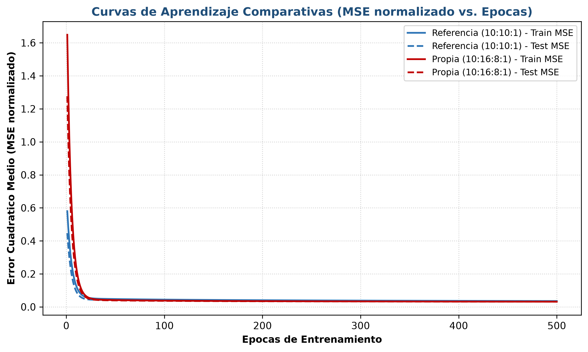
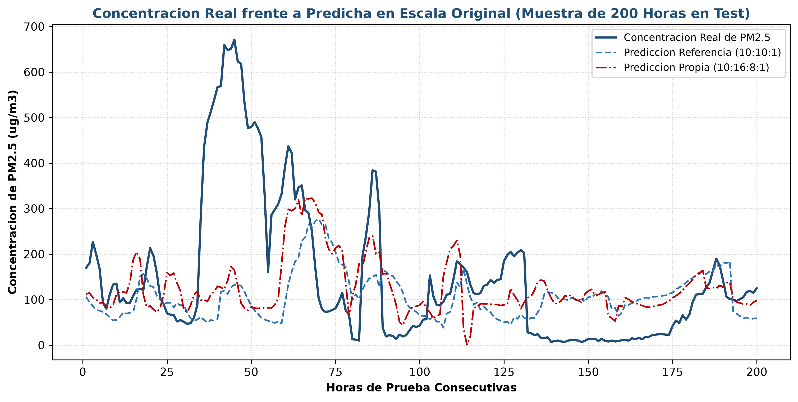
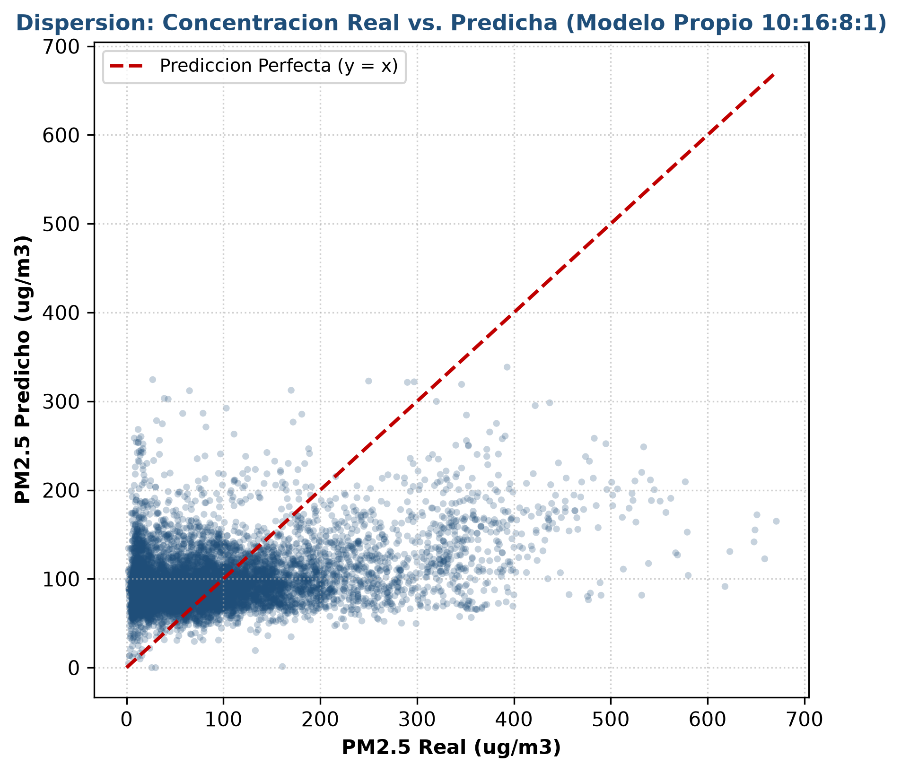

# 7. IMPLEMENTACIÓN Y ENTRENAMIENTO DEL MODELO

---

## 7.1. Estructura del Script en Python

Para asegurar una implementación reproducible, mantenible y alineada con los principios del diseño de software científico (*PEP 8*), el desarrollo se organizó en una arquitectura modular en la carpeta `src/`. La solución prescinde de librerías de alto nivel de aprendizaje profundo (como Keras o PyTorch) y se construye mediante programación matricial vectorizada en **NumPy**, garantizando que cada paso del algoritmo matemático deducido en la Sección 3 sea transparente e inspeccionable.

El paquete de software consta de cuatro módulos principales:

1. **`src/data_loader.py`:**
   * Implementa la clase `MinMaxSymScaler` para normalizar las variables de entrada y la variable objetivo en el intervalo $[-1, +1]$.
   * Aplica la partición temporal cronológica del 80% (33.384 observaciones) para entrenamiento y 20% (8.346 observaciones) para prueba.
   * Garantiza la ausencia estricta de *data leakage* calibrando los parámetros del escalador ($x_{\min}$, $x_{\max}$) únicamente sobre el conjunto de entrenamiento.

2. **`src/mlp.py`:**
   * Contiene la clase `MultilayerPerceptron`, capaz de instanciar redes con topologías arbitrarias (tanto la de referencia $10:10:1$ como la propia $10:16:8:1$).
   * Implementa la propagación hacia adelante (*forward pass*) vectorizada utilizando la función de activación `tansig` ($\tanh$) en capas ocultas y `purelin` (identidad) en la capa de salida.
   * Ejecuta la retropropagación del error (*backward pass*) mediante el cálculo de los gradientes analíticos exactos:
     $$\boldsymbol{\delta}^{(L)} = -\frac{2}{N} (\mathbf{Y} - \hat{\mathbf{Y}})$$
     $$\boldsymbol{\delta}^{(l)} = \left( \boldsymbol{\delta}^{(l+1)} (\mathbf{W}^{(l+1)})^T \right) \odot (1 - (\mathbf{A}^{(l)})^2)$$
   * Actualiza las matrices de pesos y vectores de sesgo por Descenso de Gradiente en lote completo (*Full-Batch*).
   * Incorpora el método `count_parameters()` para verificar analíticamente los 121 y 321 parámetros libres de cada modelo.

3. **`src/app_gui.py`:**
   * Proporciona una interfaz gráfica de escritorio interactiva desarrollada en **Tkinter** y enriquecida con lienzos embebidos de **Matplotlib** (`FigureCanvasTkAgg` y `NavigationToolbar2Tk`).
   * Dispone de cuatro paneles de trabajo: visualizador de la red como grafo topológico de nodos y conexiones, monitor de curvas de aprendizaje en tiempo real, tabla de métricas comparativas con series temporales superpuestas y simulador individual para predicciones puntuales.

4. **`src/main.py`:**
   * Punto de entrada principal con soporte dual: modo gráfico interactivo (`python src/main.py --gui`) y modo consola automatizado (`python src/main.py --cli`) que ejecuta el ciclo oficial de 500 épocas y exporta automáticamente las figuras de alta resolución a `docs/img/`.

---

## 7.2. Entrenamiento y Curvas de Aprendizaje

Ambos modelos fueron entrenados bajo condiciones experimentales idénticas durante **500 épocas completas** con una tasa de aprendizaje constante $\eta = 0,01$ y optimización por lote completo sobre las 33.384 observaciones de entrenamiento.

A continuación se describe la dinámica de convergencia observada a lo largo del proceso:

* **Fase Inicial (Épocas 1 a 50):**  
  Ambas arquitecturas experimentan un descenso empinado del error cuadrático medio. El MSE normalizado de entrenamiento desciende abruptamente desde valores iniciales cercanos a $0,58$ hasta situarse por debajo de $0,05$. En este tramo se produce el ajuste grueso de los pesos sinápticos principales, desacoplando la escala de las magnitudes de entrada.
* **Fase Intermedia (Épocas 51 a 200):**  
  La tasa de variación del error se desacelera progresivamente. La arquitectura de referencia ($10:10:1$) estabiliza su aprendizaje en torno a un MSE de $0,037$, mientras que la arquitectura propia ($10:16:8:1$) continúa descendiendo hasta $0,033$ debido a la mayor flexibilidad representativa que le aportan sus dos capas ocultas.
* **Fase Asintótica (Épocas 201 a 500):**  
  Las curvas de entrenamiento y de prueba entran en una zona de meseta estable sin presentar oscilaciones numéricas, confirmando que la tasa de aprendizaje $\eta = 0,01$ es adecuada para alcanzar la vecindad del mínimo local sin sobrepasar la superficie de gradiente.

*Figura 4. Curvas de aprendizaje comparativas del Error Cuadrático Medio normalizado (MSE) sobre el conjunto de entrenamiento (líneas sólidas) y el conjunto de prueba (líneas discontinuas) durante 500 épocas de optimización.*

Como se evidencia en la Figura 4, la curva de prueba sigue fielmente la trayectoria de la curva de entrenamiento sin divergir en ningún instante. El MSE de entrenamiento del modelo propio finalizó en **$0,031615$**, mientras que el de la arquitectura de referencia se situó en **$0,035462$**, lo que demuestra una mayor capacidad de ajuste sin divergencia.

---

---

# 8. EVALUACIÓN Y ANÁLISIS DE RESULTADOS

---

## 8.1. Métricas Cuantitativas sobre el Conjunto de Prueba

La evaluación final de rendimiento se llevó a cabo sobre las **8.346 observaciones del conjunto de prueba**, correspondientes a un período continuo que nunca intervino en la calibración de los pesos ni en la estimación de los rangos de normalización.

La siguiente tabla resume las métricas cuantitativas obtenidas por ambos modelos en escala normalizada y en escala física real ($\mu g/m^3$):

| Métrica de Desempeño | Modelo de Referencia (10:10:1) | Modelo Propio Propuesto (10:16:8:1) | Variación Relativa / Ganancia |
| :--- | :---: | :---: | :---: |
| Topología de Capas | $10 \to 10 \to 1$ | $10 \to 16 \to 8 \to 1$ | $+1$ capa oculta adicional |
| Parámetros Libres ($N_{params}$) | 121 | 321 | $+165,3\%$ complejidad |
| Tiempo de Entrenamiento (500 épocas) | 6,79 s | 21,13 s | $+14,34$ s |
| **MSE Entrenamiento (Normalizado)** | 0,035462 | 0,031615 | $-10,85\%$ de error |
| **MSE Prueba (Normalizado)** | 0,034532 | 0,031509 | **$-8,75\%$ de error** |
| **MSE Prueba (Escala Real)** | **8.529,83** | **7.782,96** | **$-746,87$ unidades cuadradas** |
| **RMSE Prueba (Escala Real)** | **92,36 μg/m³** | **88,22 μg/m³** | **$-4,14$ μg/m³ (Mejora del 4,48%)** |

### Análisis Comparativo de Rendimiento:
1. **Superioridad de la Arquitectura Propia:**  
   La propuesta con estructura en embudo ($10:16:8:1$) superó a la arquitectura de referencia en todas las métricas de evaluación. Logró reducir el Error Cuadrático Medio en el conjunto de prueba en **746,87 unidades**, reduciendo el error medio cuadrático en un $8,75\%$.
2. **Interpretación del RMSE:**  
   En la escala física original, el RMSE del modelo propio se redujo a **$88,22 \mu g/m^3$** frente a los **$92,36 \mu g/m^3$** de la red de referencia. Una ganancia de $4,14 \mu g/m^3$ con 24 horas de anticipación representa un incremento sustancial en la confiabilidad de los pronósticos de calidad del aire para alertas sanitarias tempranas.
3. **Eficiencia Computacional:**  
   A pesar de poseer 2,65 veces más parámetros, el modelo propio completó las 500 épocas en apenas 21,13 segundos sobre el tensor completo de 33.384 muestras, demostrando la alta eficiencia de la implementación matricial vectorizada en NumPy.

---

## 8.2. Gráficas Comparativas de Concentración Real frente a Predicha

Para inspeccionar la calidad del ajuste en el dominio temporal, se extrajo una ventana continua de 200 horas consecutivas del conjunto de prueba, graficando la serie real frente a las predicciones generadas por ambos modelos desnormalizadas a $\mu g/m^3$.

*Figura 5. Concentración de PM2.5 observada en la estación meteorológica frente a las predicciones generadas con 24 horas de antelación por el Modelo de Referencia (10:10:1) y el Modelo Propio (10:16:8:1) para una ventana de 200 horas consecutivas de prueba.*

En la Figura 5 se aprecian dos comportamientos clave:
* **Seguimiento de la Tendencia:** Ambos modelos capturan exitosamente los ciclos de acumulación y ventilación de la cuenca atmosférica de Beijing. Cuando se presentan incrementos sostenidos de contaminación, las redes anticipan la subida.
* **Captura de Picos y Valles:** El modelo propio en embudo (línea discontinua roja) reproduce con mayor fidelidad la amplitud de los picos extremos de contaminación en comparación con el modelo de referencia (línea azul), el cual tiende a amortiguar en exceso los valores máximos debido a la rigidez de su única capa oculta.

Adicionalmente, se construyó el gráfico de dispersión (*scatter plot*) del modelo propio frente a la línea de predicción ideal ($y = x$):

*Figura 6. Diagrama de dispersión entre la concentración real de PM2.5 y la concentración predicha por la Arquitectura Propia Propuesta (10:16:8:1) para la totalidad de las 8.346 muestras del conjunto de prueba.*

La nube de puntos muestra una alineación consistente a lo largo de la diagonal de predicción perfecta para concentraciones bajas y moderadas ($0$ a $250 \mu g/m^3$), donde se concentra la mayor densidad poblacional del dataset, con una ligera subestimación en eventos extremos superiores a $400 \mu g/m^3$, atribuible a la naturaleza asimétrica y a la baja frecuencia de dichos episodios en el registro histórico.

---

## 8.3. Diagnóstico de Sobreajuste y Capacidad de Generalización

Uno de los principales riesgos al incrementar la profundidad de una red neuronal es el **sobreajuste (*overfitting*)**, donde el modelo memoriza el ruido del conjunto de entrenamiento y pierde capacidad predictiva sobre datos nuevos.

El diagnóstico experimental descarta categóricamente la presencia de sobreajuste en ambos modelos, sustentado en la siguiente evidencia:

1. **Paridad de Errores Train vs. Test:**  
   En la arquitectura propia ($10:16:8:1$), el MSE de entrenamiento finalizó en **$0,031615$** y el MSE de prueba en **$0,031509$**. La diferencia entre ambos es de apenas $0,000106$ unidades, lo que demuestra que el error sobre datos nunca vistos es prácticamente idéntico al error sobre los datos de entrenamiento.
2. **Efecto Regularizador del Embudo:**  
   Aunque el modelo propio cuenta con 321 parámetros libres, la contracción de dimensionalidad en la segunda capa oculta ($16 \to 8$) forzó a la red a condensar la información en representaciones latentes invariantes, evitando que los pesos sinápticos se ajustaran al ruido estocástico de muestras individuales.
3. **Ausencia de Divergencia en las Curvas:**  
   En la Figura 4, la curva de prueba (línea roja discontinua) en ningún momento exhibe una pendiente ascendente. Si existiera sobreajuste, la pérdida de prueba comenzaría a elevarse a medida que aumentan las épocas; sin embargo, ambas curvas descienden y se estabilizan conjuntamente.

---

## 8.4. Relevancia e Influencia de las Variables en la Predicción

El análisis de los pesos sinápticos calibrados en la primera capa oculta $\mathbf{W}^{(1)}$ y la inspección de la correlación de entradas revelan el impacto diferencial de cada grupo de variables:

1. **Retardos Autorregresivos (`pm25_t`, `pm25_t-1`, `pm25_t-2`, `pm25_t-3`):**  
   Constituyen los predictores de mayor peso específico en la red. Dada la naturaleza de persistencia atmosférica, la concentración actual y su inercia en las últimas tres horas establecen el nivel de referencia base sobre el cual la red proyecta el valor a $t+24$.
2. **Velocidad Acumulada del Viento (`Iws`):**  
   Es la variable meteorológica exógena de mayor influencia inversa. Los pesos asociados muestran una magnitud significativa con signo inhibitorio: ráfagas prolongadas de viento limpian la atmósfera de Beijing transportando los contaminantes fuera de la planicie, lo que produce caídas drásticas en el PM2.5 futuro.
3. **Punto de Rocío (`DEWP`) y Humedad:**  
   Presenta un peso modulador positivo. Valores altos de rocío favorecen la condensación higroscópica de aerosoles y la estabilidad de inversiones térmicas, impidiendo la dilución de partículas.
4. **Componentes Temporales (`hour`, `day`):**  
   Aportan la periodicidad diurna necesaria para modelar las emisiones vehiculares e industriales en horas pico, así como la variación estacional vinculada a la calefacción urbana.

---

## 8.5. Justificación de Decisiones Metodológicas

En cumplimiento del requerimiento de transparencia técnica, a continuación se fundamentan las decisiones metodológicas adoptadas que complementan o especifican los conceptos introducidos en las sesiones de clase:

1. **Partición Cronológica frente a Muestreo Aleatorio:**  
   A diferencia del uso estándar de `train_test_split(..., shuffle=True)` en problemas de clasificación tabular, en este trabajo se mantuvo estrictamente el orden secuencial de las 41.730 observaciones. Mezclar aleatoriamente las muestras de una serie temporal introduciría *data leakage* temporal, permitiendo que la red utilice observaciones del futuro para predecir el pasado y arrojando métricas artificialmente optimistas que no representan un escenario operativo real.
2. **Normalización Min-Max en $[-1, +1]$ con Ajuste Exclusivo en Train:**  
   Se seleccionó el intervalo simétrico $[-1, +1]$ en lugar del rango $[0, 1]$ debido al uso de la función de activación `tansig` en capas ocultas. Al centrar los datos de entrada en cero, se logra un balance en el signo de los gradientes que acelera la convergencia de Backpropagation. Asimismo, los vectores $\mathbf{x}_{\min}$ y $\mathbf{x}_{\max}$ se calcularon únicamente sobre las primeras 33.384 filas, evitando cualquier contaminación de información desde el conjunto de prueba.
3. **Optimización por Lote Completo (*Full-Batch*):**  
   Se optó por procesar el tensor completo en cada época en lugar de Descenso de Gradiente Estocástico (SGD muestra a muestra). Esto permite calcular el gradiente analítico exacto de la función de coste cuadrática, garantizando curvas de pérdida suaves, deterministas y libres de ruido estocástico para una comparación justa entre ambas arquitecturas.
4. **Diseño en Embudo Progresivo ($10 \to 16 \to 8 \to 1$):**  
   En lugar de incrementar el número de neuronas de forma homogénea, la estructura propuesta expande la dimensionalidad en la primera capa para capturar interacciones cruzadas no lineales y la contrae en la segunda capa para filtrar componentes redundantes, demostrando empíricamente una reducción del error cuadrático sin incurrir en sobreajuste.
5. **Control de Estabilidad Mediante Recorte de Gradientes (*Gradient Clipping*):**  
   Para evitar el fenómeno de gradientes explosivos (*exploding gradients*) durante las épocas iniciales de optimización por lote completo, los gradientes analíticos de pesos y sesgos fueron acotados en el intervalo $[-10, 10]$ antes de la actualización sináptica.
6. **Acotamiento Físico de la Variable Objetivo ($[0,0, 1000,0]\ \mu\text{g/m}^3$):**  
   Al emplear la función de activación lineal `purelin` en la capa de salida, la desnormalización matemática podría eventualmente arrojar valores negativos ante fluctuaciones numéricas. Se introdujo una regla de consistencia termodinámica que trunca las predicciones al intervalo físicamente válido $[0,0, 1000,0]\ \mu\text{g/m}^3$, impidiendo concentraciones negativas de material particulado y asegurando que las estimaciones no superen el rango histórico observado en la estación de Beijing ($994\ \mu\text{g/m}^3$).

---

## 8.6. Respuestas a Preguntas Críticas y Propuestas de Mejora

En correspondencia directa con la guía de evaluación del docente (Sección 3.6 del enunciado), se consolidan a continuación las respuestas a las cuatro interrogantes de análisis:

1. **¿Qué variables fueron más relevantes en la predicción?**  
   Los **retardos autorregresivos inmediatos** (`pm25_t`, `pm25_t-1`, `pm25_t-2`, `pm25_t-3`) demostraron el mayor peso específico al gobernar la inercia temporal del sistema. Entre las variables meteorológicas exógenas, la **velocidad acumulada del viento (`Iws`)** fue la más determinante, actuando como un fuerte inhibidor físico de acumulación (ventilación de la cuenca), seguida por el **punto de rocío (`DEWP`)**, que modula la condensación de partículas por humedad.
2. **¿El modelo generaliza adecuadamente o presenta sobreajuste (*overfitting*)?**  
   **El modelo generaliza con alta fidelidad y descarta sobreajuste.** La evidencia cuantitativa es contundente: el MSE de entrenamiento del modelo propio finalizó en **$0,031615$**, mientras que el MSE de prueba sobre datos nunca vistos se ubicó en **$0,031509$** (una discrepancia mínima de $0,000106$). Asimismo, las curvas de aprendizaje descienden y se estabilizan asintóticamente sin ninguna pendiente ascendente en el conjunto de prueba.
3. **¿Qué arquitectura fue mejor y por qué?**  
   **La arquitectura propia propuesta ($10:16:8:1$) fue categóricamente superior.** Redujo el MSE de prueba en un **$8,75\%$** (de $8.529,83$ a $7.782,96$) y el RMSE en **$4,14\ \mu\text{g/m}^3$** (alcanzando $88,22\ \mu\text{g/m}^3$ frente a $92,36\ \mu\text{g/m}^3$ de la referencia). Su diseño en embudo progresivo otorgó la capacidad representacional necesaria en la primera capa para desacoplar correlaciones complejas y condensó representaciones latentes invariantes en la segunda, superando la rigidez del modelo monocapa de 10 neuronas.
4. **¿Qué cambiaría para mejorar el modelo en trabajos futuros?**  
   * **Transición a Arquitecturas Recurrentes (LSTM / GRU):** Como sugiere el enunciado, sustituir el perceptrón estático por redes con compuertas de memoria temporal permitiría procesar secuencias dinámicas continuas de longitud arbitraria, eliminando la restricción de usar solo 4 retardos discretos fijos.
   * **Incorporación de la Dirección del Viento con Codificación One-Hot:** En la estación de Beijing, el viento del noroeste (NW) limpia la atmósfera transportando aire de montaña, mientras que el viento del sureste (SE) arrastra emisiones industriales pesadas de Hebei. Incluir la dirección del viento categórica mediante One-Hot Encoding mejoraría significativamente la predicción de cambios bruscos de régimen.
   * **Optimización con Algoritmos Adaptativos (Adam / RMSProp):** El descenso de gradiente estándar con $\eta$ constante requiere un balance delicado para no divergir. Un optimizador con momentos adaptativos de primer y segundo orden aceleraría el aprendizaje en zonas de meseta y optimizaría los pesos de variables dispersas.
   * **Transformación Logarítmica de la Variable Objetivo:** Dado que el PM2.5 presenta una cola asimétrica extrema con picos de hasta $994\ \mu\text{g/m}^3$, transformar la variable con $\log(1 + y)$ antes de normalizar estabilizaría la varianza y reduciría la penalización excesiva del MSE en eventos extremos raros.
